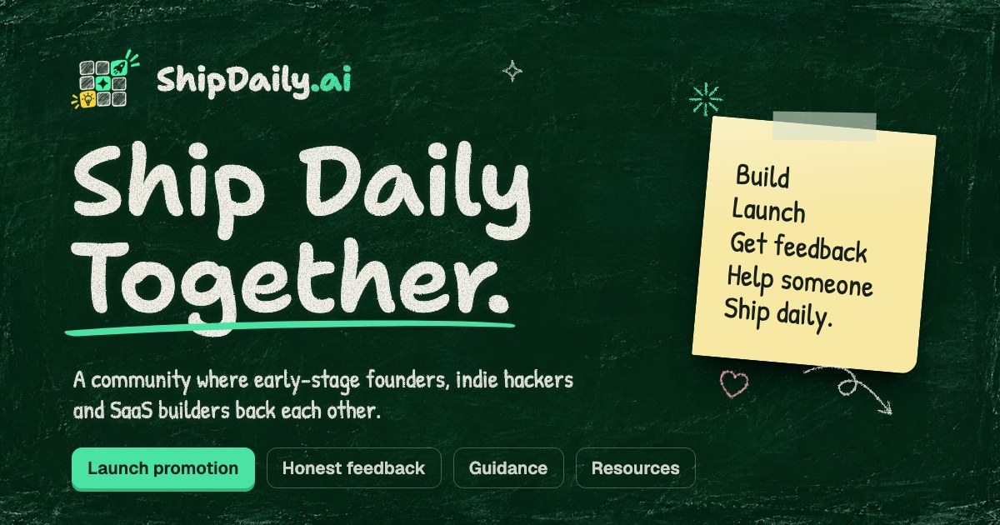

<div align="center">

<a href="https://shipdaily.ai">
  
</a>

<h1>ShipDaily</h1>

<p><strong>The open-source launchpad where products grow in public.</strong><br />
Launch, get real feedback, ship updates, relaunch.</p>

<p>
  <a href="https://shipdaily.ai">Website</a> ·
  <a href="https://discord.gg/ZeqkBS9nuu">Discord</a> ·
  <a href="https://github.com/ship-daily/shipdaily/issues">Issues</a> ·
  <a href="#contributing">Contributing</a>
</p>

<p>
  <a href="./LICENSE"></a>
  <a href="https://discord.gg/ZeqkBS9nuu"></a>
  <a href="https://github.com/ship-daily/shipdaily/stargazers"></a>
  
</p>

</div>

---

## Why ShipDaily

Building got cheap. Getting anyone to actually try what you built didn't.

Most launchpads give you one day of vote-begging, then nothing. ShipDaily is built around what happens *after* launch day: real people trying your product, telling you what's wrong, and coming back when you've fixed it.

## What we're building

> [!NOTE]
> The landing page is live at [shipdaily.ai](https://shipdaily.ai). The app is being built in this repo, in the open. Follow along on [Discord](https://discord.gg/ZeqkBS9nuu).

| | |
|---|---|
| 🧱 **Product pages** | A living page per product: changelog, launch history, and how reactions changed between launches. |
| 🟩 **Ship graph** | A GitHub-style contribution graph for shipping. Updates and launches fill the squares. No streaks, no guilt. Embeddable in your README. |
| 🚀 **Launch Weeks** | Small cohorts of ~20 products, so every launch actually gets seen. |
| ✅ **"Tried it" votes** | A vote only counts after someone opens your product and leaves a one-line reaction. |
| 🔁 **Feedback credits** | Give-to-get: try other products to earn credits, spend them to launch. Every launch gets real testers. |
| 📣 **Relaunch** | Ship a big update, relaunch it, and everyone who tried the last version gets notified. |

## Open source

ShipDaily is [AGPL-3.0](./LICENSE). The whole platform is public and you're free to run it yourself. If you run a modified version as a service, you share your changes back.

The only things kept out of this repo are anti-abuse thresholds and ranking weights. Publishing them would make the system easy to game, so they're read from environment variables instead.

## Getting started

**Requirements:** [Bun](https://bun.sh) 1.3+

```bash
git clone https://github.com/ship-daily/shipdaily.git
cd shipdaily
bun install
bun dev
```

Open [http://localhost:3000](http://localhost:3000).

| Command | What it does |
|---|---|
| `bun dev` | Start the dev server |
| `bun run build` | Production build |
| `bun run start` | Serve the production build |
| `bun run lint` | Run ESLint |

## Project structure

```
src/
├── app/
│   ├── (marketing)/      # landing page at /
│   └── layout.tsx        # root layout: fonts, metadata
├── components/
│   ├── marketing/        # landing page sections and chalk doodles
│   └── ui/               # shared components (logo, …)
└── lib/
    └── site.ts           # URLs, nav links, community channels
```

App routes will live alongside `(marketing)` in `src/app/`.

## Tech stack

- [Next.js 16](https://nextjs.org) (App Router) + React 19 + TypeScript
- [Tailwind CSS v4](https://tailwindcss.com)
- [Bun](https://bun.sh)

## Contributing

Issues and pull requests are welcome.

- **Small fixes** (typos, bugs, copy): open a PR directly.
- **Bigger changes** (new features, refactors): open an issue first so we can agree on the approach before you put time in.
- **Not sure?** Ask in [Discord](https://discord.gg/ZeqkBS9nuu).

Before opening a PR, make sure `bun run lint` and `bun run build` pass.

## Community

- 💬 [Discord](https://discord.gg/ZeqkBS9nuu) — where the community lives
- 🌐 [shipdaily.ai](https://shipdaily.ai)

## License

[AGPL-3.0](./LICENSE) © ShipDaily
